# EMBERFALL: Mobile Game Menu System

**CS-464 Lab 07 | Omer Abdullah | BSCS25135**

EMBERFALL is a ten-screen menu system for an elemental arena brawler (Ember vs Frost clans), built in Unity with Unity UI and TextMeshPro. It uses one scene, one Canvas, ten panels and one `ScreenManager` script that handles navigation and a back stack.

**Demo video:** https://drive.google.com/file/d/1w5o81Lw5cdUXZ-FKqKo4OhGQC3f4PmzT/view?usp=drive_link

## Setup and run

- **Unity version:** 6000.3.24f1 (Unity 6.3 LTS), **Universal 3D (URP)** template.
- Clone the repository, then in Unity Hub use **Add > Add project from disk** and select the folder. The first open takes a few minutes while Unity regenerates `Library/`, which is not committed.
- Open `Assets/Scenes/MainMenu.unity`, set the Game view to **Full HD (1920x1080)** landscape, and press **Play**.
- Keyboard **Esc** acts as the Android Back button.

## Screen flow

Title > Main Menu > (Mode Select > Legend Select > Match <> Pause > Results) / Shop / Settings / Credits. Back is always top-left; Match opens Pause with Esc or the Pause button; Results offers Rematch and Main Menu. No screen is a dead end.

## Palette and motion (shared by all screens)

Navy `#0E1020` (60%), Indigo `#1B1F3A` (30%), Ember Orange `#FF7A1A` (10%, primary action only), Frost Cyan `#3CD6F2`, Gold `#FFC83D` (currency only), Danger `#FF5468` (destructive only), Text `#F4F1EA`. Font: Liberation Sans SDF (TextMeshPro default). All tweens come from my own coroutine helper (`Tween.cs`) using standard easing equations, on unscaled time. Screen change: leave 0.18 s **InCubic** (leaving is quick), arrive 0.30 s **OutCubic** (arriving settles). Button press: scale to 0.94 with **OutCubic** 0.08 s, release with **OutBack** 0.2 s (confirms the touch and springs back).

---

## 1. Title

| Annotated colour | Greyscale |
|---|---|
| 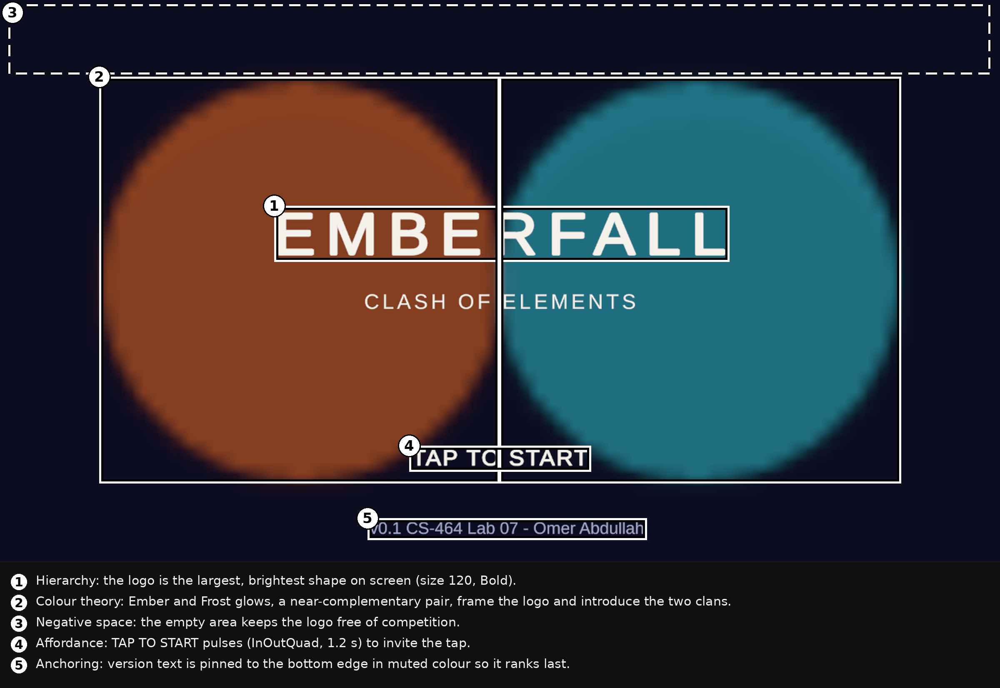 | 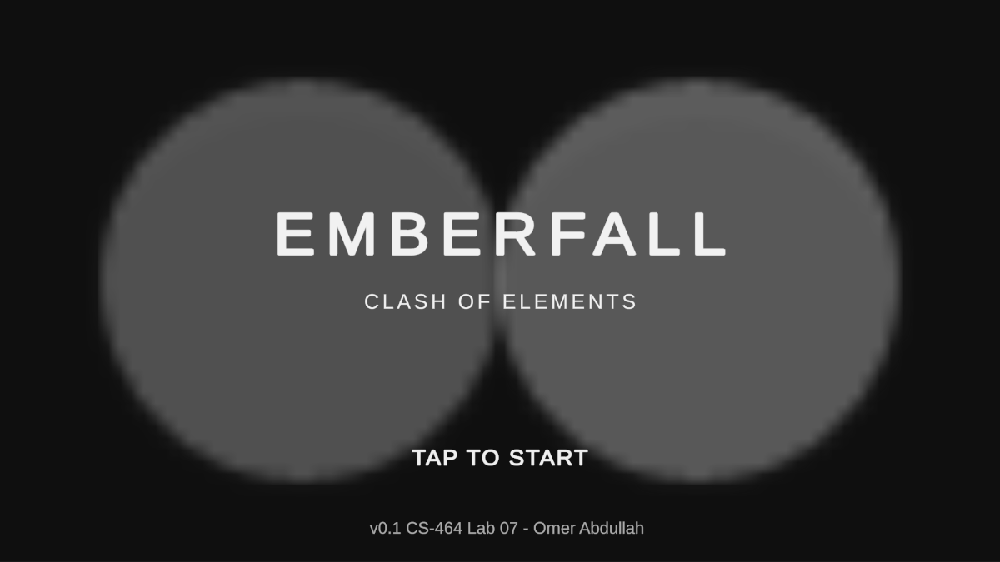 |

**Purpose:** brand moment and entry point; one action, tap to continue.
**Principles:** hierarchy (largest logo), complementary Ember and Frost glows, negative space, affordance (TAP TO START), edge-anchored version text.
**Tweens:** logo scale 0.8 to 1, **OutBack** 0.6 s (arrives with weight); TAP TO START alpha pulse, **InOutQuad** 1.2 s loop (invites action without jarring).
**Greyscale check:** No change was needed. The cream logo stays far brighter than both glows, and the subtitle and TAP TO START remain clear.

## 2. Main Menu

| Annotated colour | Greyscale |
|---|---|
| 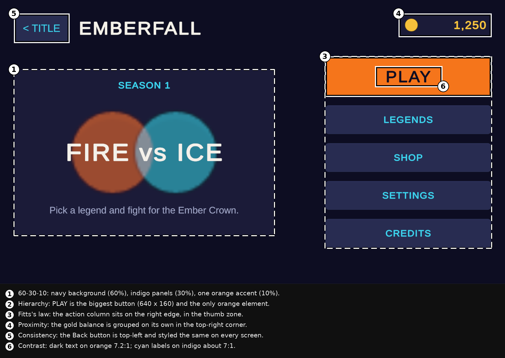 | 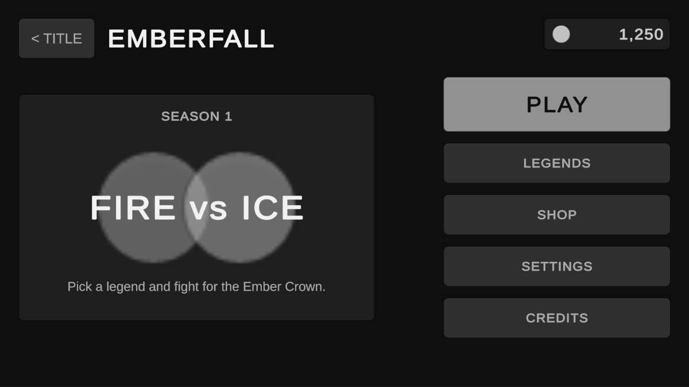 |

**Purpose:** hub to every part of the game.
**Principles:** 60-30-10 colour, hierarchy (PLAY is largest and the only orange), Fitts's law (right-edge thumb zone), proximity (gold balance grouped top-right), consistency, contrast 7.2:1 on orange.
**Tweens:** shared screen transition and button press.
**Greyscale check:** No change was needed. PLAY stays about 4.7:1 brighter than the secondary buttons, and it is also the largest.

## 3. Mode Select

| Annotated colour | Greyscale |
|---|---|
| 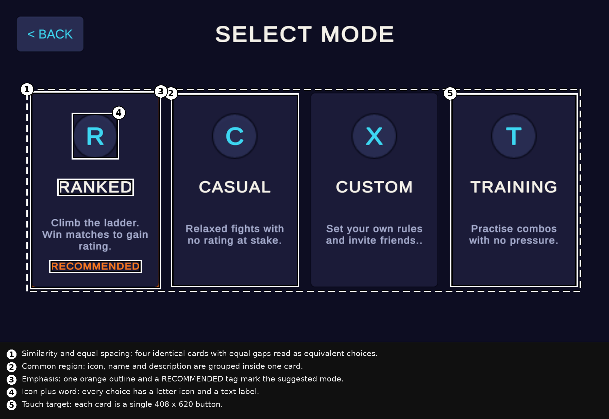 | 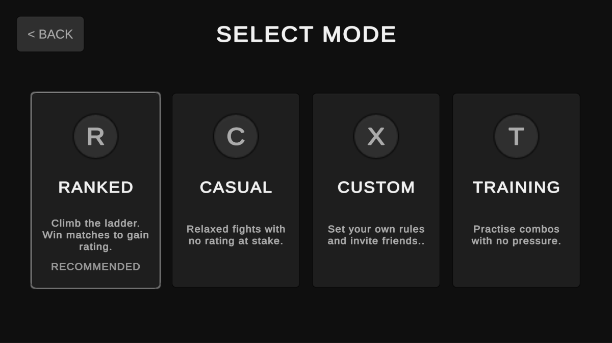 |

**Purpose:** choose Ranked, Casual, Custom or Training.
**Principles:** similarity and equal spacing (four identical cards), common region, emphasis (one orange outline and RECOMMENDED tag), icon plus word, large touch targets.
**Tweens:** shared screen transition; card press **OutCubic** then **OutBack**.
**Greyscale check:** No change was needed. The outline and RECOMMENDED tag stay clearly lighter than the card.

## 4. Legend Select

| Annotated colour | Greyscale |
|---|---|
| 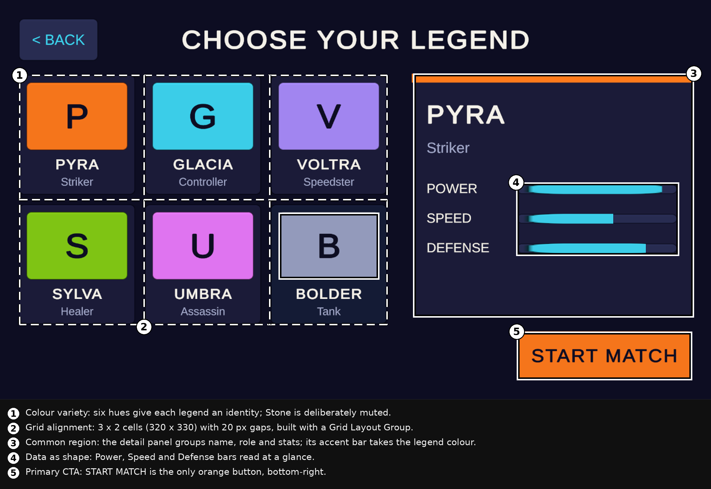 | 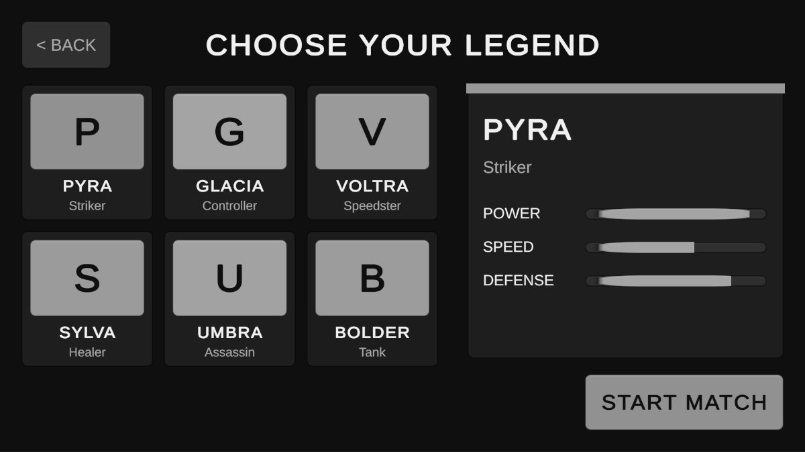 |

**Purpose:** pick a legend and read its stats.
**Principles:** colour variety (six hues, Stone deliberately muted), grid alignment (3 x 2, 20 px gaps), common region (detail panel with accent bar), data as shape (stat bars), one primary CTA.
**Tweens:** detail panel scale 0.94 to 1, **OutBack** 0.25 s (signals changed content); stat bars fill, **OutCubic** 0.4 s (shows what changed).
**Greyscale check:** Hue alone no longer separates the six portraits (all turn into similar mid-greys). They stay distinguishable through non-colour cues: a large letter on each, name and role labels, and the detail panel naming the selected legend. I kept the design for that reason.

## 5. Shop

| Annotated colour | Greyscale |
|---|---|
| 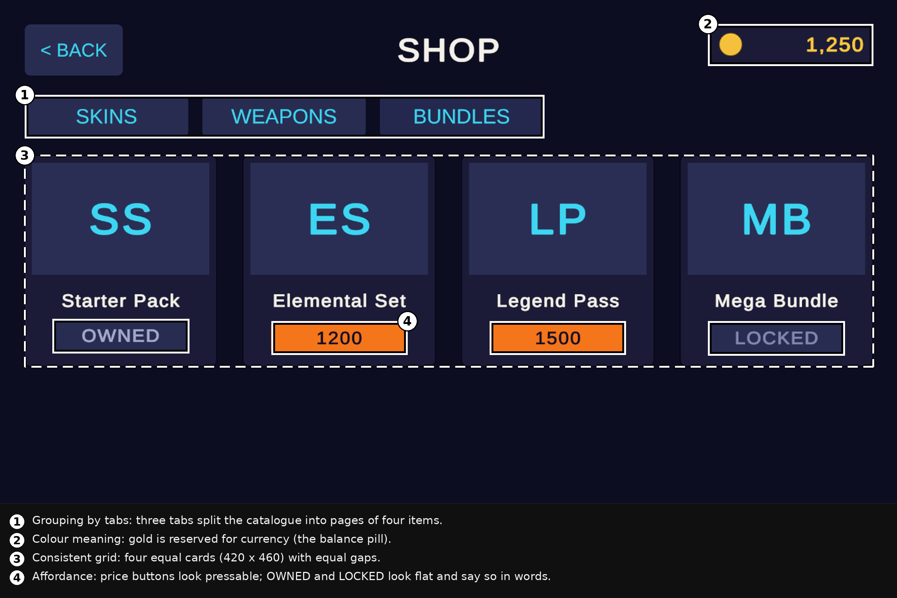 | 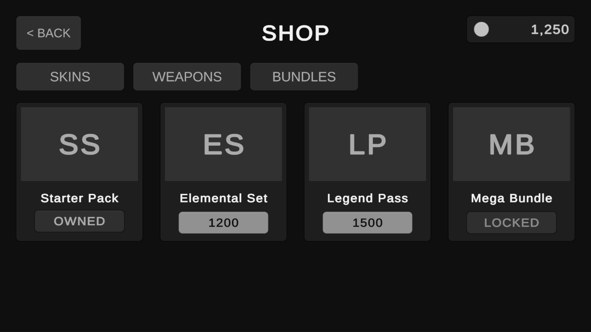 |

**Purpose:** browse Skins, Weapons and Bundles (visual prototype).
**Principles:** grouping by tabs, gold reserved for currency, consistent 4-column card grid, affordance (price buttons look pressable; OWNED and LOCKED look flat and say so in words).
**Tweens:** tab underline slides to the active tab, **OutCubic** 0.2 s (shows the active tab); button press as above.
**Greyscale check:** [UPDATE AFTER RE-CAPTURING: state what you changed, e.g. a visible active-tab underline and OWNED vs LOCKED cues, or write "No change was needed because ..."]

## 6. Settings

| Annotated colour | Greyscale |
|---|---|
| 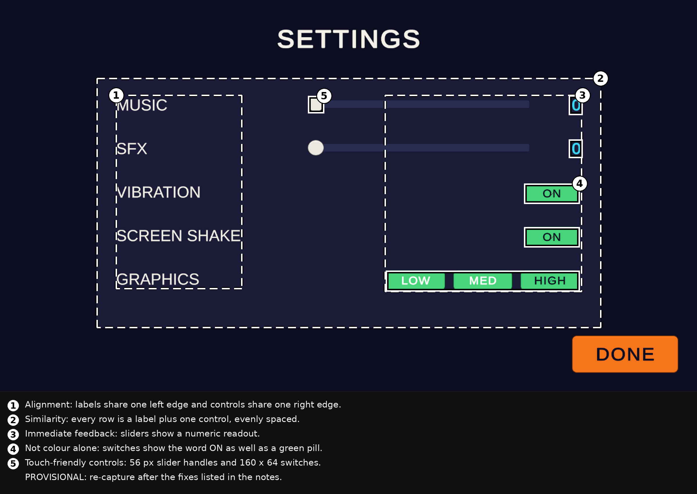 | 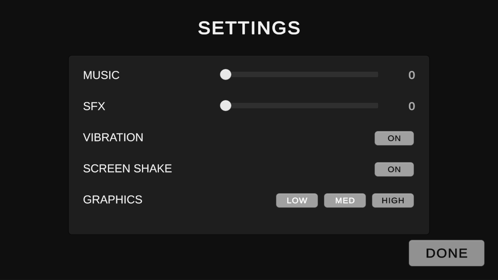 |

**Purpose:** change music and effects volume, vibration, screen shake and graphics quality.
**Principles:** alignment (labels left, controls on one right edge), similarity (same row pattern), immediate feedback (numeric readouts, ON/OFF words), not colour alone, touch-friendly controls.
**Tweens:** shared screen transition; built-in colour tint on controls (0.1 s) for state feedback.
**Greyscale check:** [UPDATE AFTER RE-CAPTURING: state what you changed, or write "No change was needed because ..."]

## 7. Match (placeholder HUD)

| Annotated colour | Greyscale |
|---|---|
| 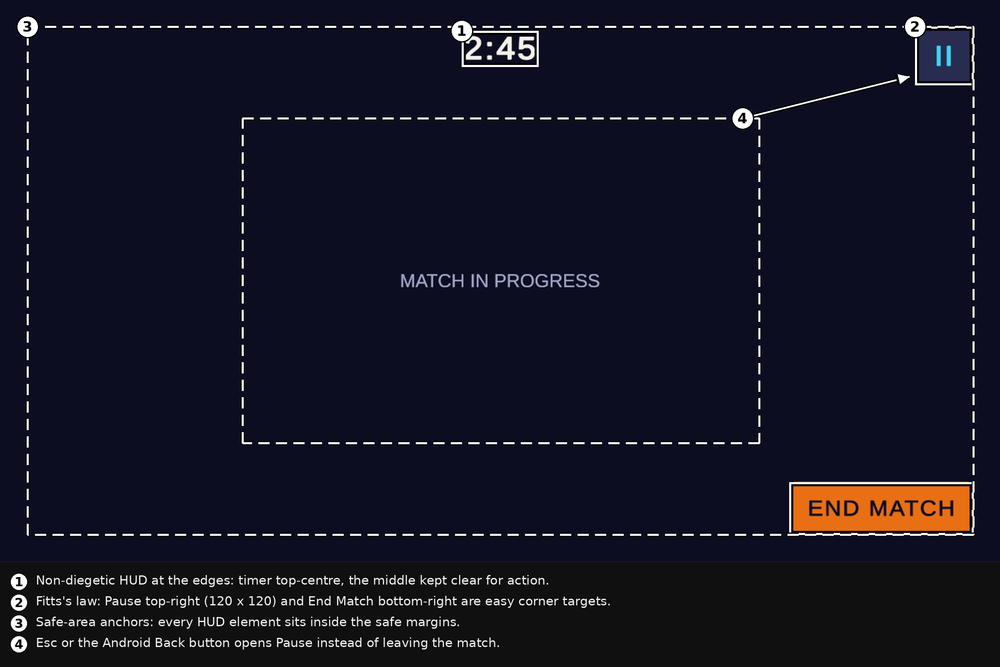 | 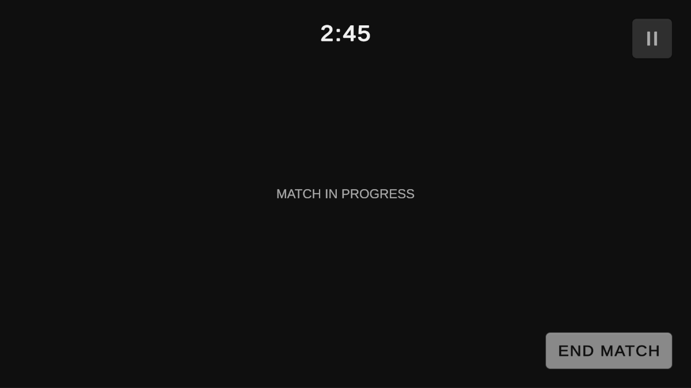 |

**Purpose:** in-game placeholder showing how menus connect to gameplay.
**Principles:** HUD kept at the edges with a clear middle, Fitts's law (Pause top-right, End Match bottom-right), safe-area anchors, Esc / Back opens Pause instead of leaving.
**Tweens:** shared screen transition and button press.
**Greyscale check:** No change was needed. The timer and END MATCH stay clear against the dark background, and the Pause icon stays visible.

## 8. Pause (overlay)

| Annotated colour | Greyscale |
|---|---|
| 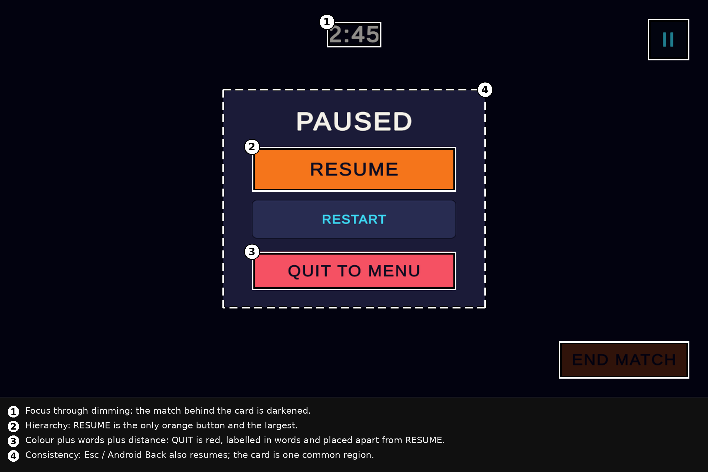 | 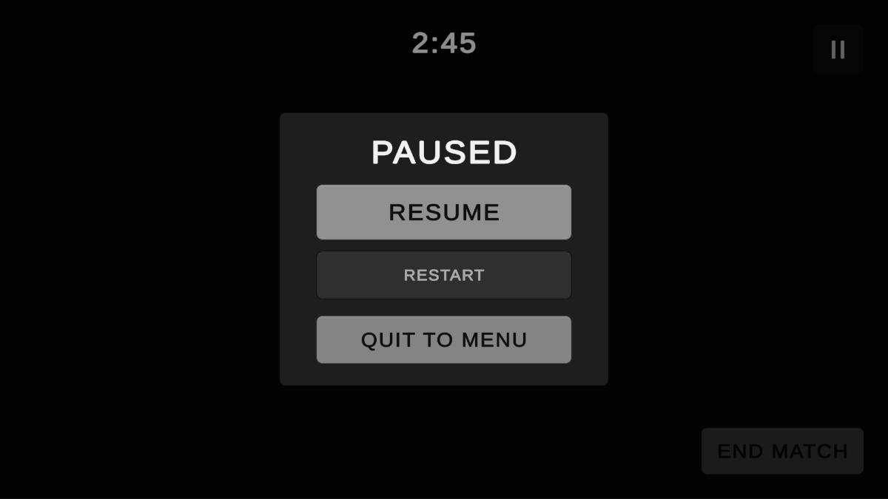 |

**Purpose:** stop the match and choose Resume, Restart or Quit.
**Principles:** focus through dimming (common region), hierarchy (RESUME is the only orange button), colour plus words plus distance on QUIT, Esc also resumes.
**Tweens:** card opens scale 0.85 to 1 with **OutBack** 0.28 s (pop-in feels like an interruption); closes with **InCubic** 0.18 s (quick exit).
**Greyscale check:** RESUME and QUIT turn into near-identical greys, so colour no longer separates them. They stay distinct by size (RESUME is larger), position (QUIT is lower and apart), their words, and a much darker RESTART between them. No change was needed.

## 9. Results

| Annotated colour | Greyscale |
|---|---|
| 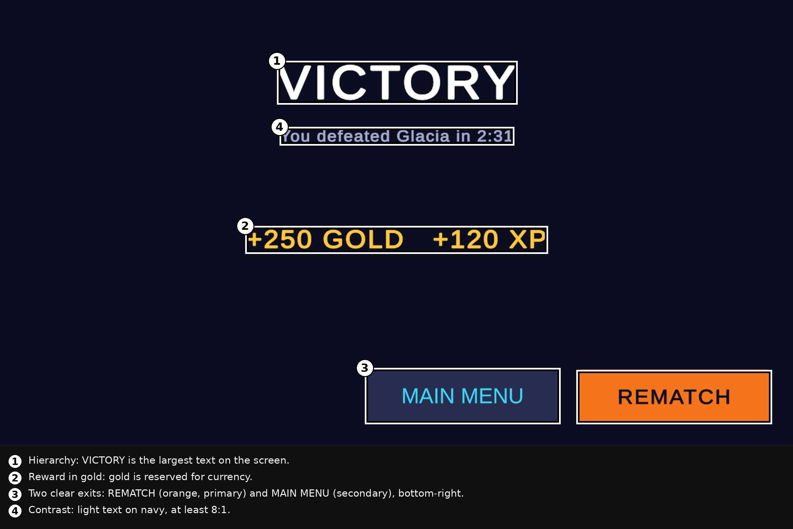 | 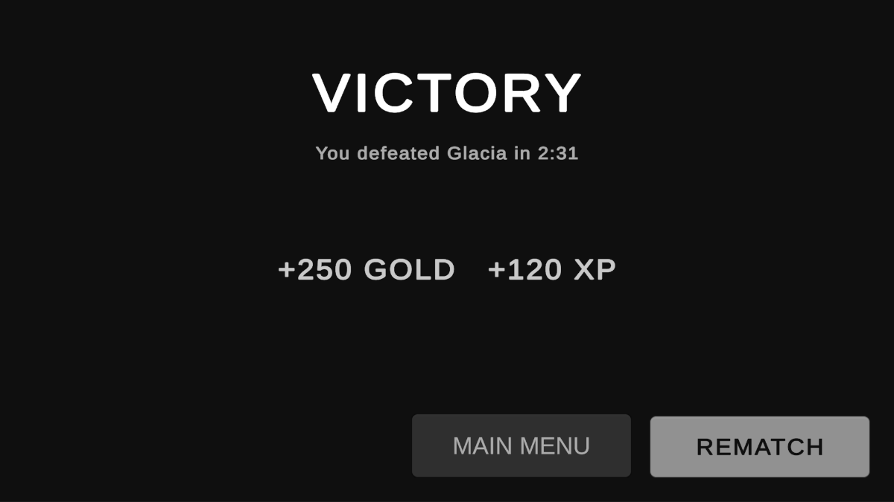 |

**Purpose:** show the outcome and reward, then offer the next step.
**Principles:** hierarchy (VICTORY is the largest text), gold only for the reward, two clear exits (orange REMATCH, secondary MAIN MENU), high contrast.
**Tweens:** VICTORY scale 0.7 to 1, **OutBack** 0.45 s (the result arrives with impact); shared screen transition.
**Greyscale check:** No change was needed. REMATCH stays about 4.7:1 brighter than MAIN MENU, and VICTORY and the reward line remain bright.

## 10. Credits

| Annotated colour | Greyscale |
|---|---|
| 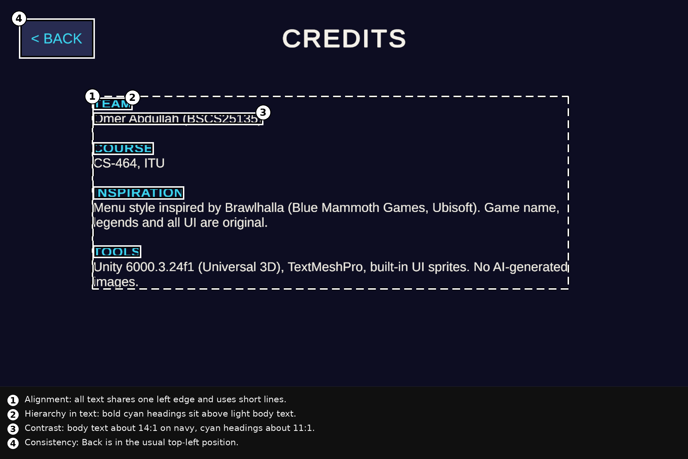 | 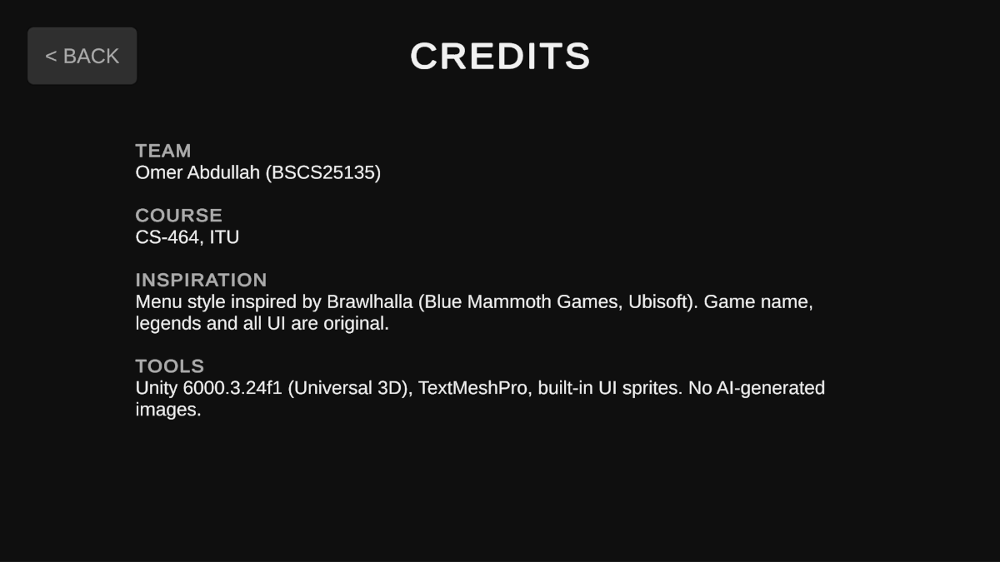 |

**Purpose:** acknowledge the author, inspiration and tools.
**Principles:** alignment on one left edge with short lines, text hierarchy (bold cyan headings over light body text), contrast about 14:1, consistent Back position.
**Tweens:** shared screen transition only; nothing else needs to move.
**Greyscale check:** No change was needed. Headings stay distinguishable from body text by bold weight, capitals and slightly lower brightness.

---

## Credits and references

- **Inspiration (style only, no assets used):** *Brawlhalla* by Blue Mammoth Games / Ubisoft. The game name, legends, layouts and all UI are original.
- **Course material:** CS-464 Lecture 08, Colour, UI Design and Menus.
- **Tools:** Unity 6000.3.24f1 (Universal 3D template), Unity UI, TextMeshPro with Liberation Sans SDF (SIL Open Font License), and Unity's built-in UI sprites.
- **No third-party assets and no AI-generated images** were used. Screenshots are captured from the Unity Game view, greyscale copies are luminance conversions, and annotations are drawn over my own screenshots.
- **References:** Robert Penner's easing equations (implemented in my own `Ease` class); W3C WCAG 2.1 contrast ratio formula.